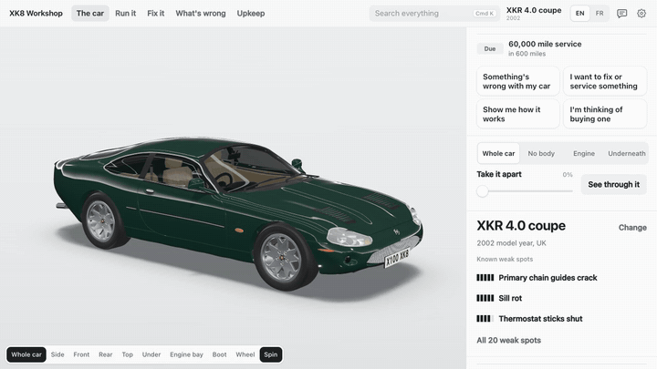
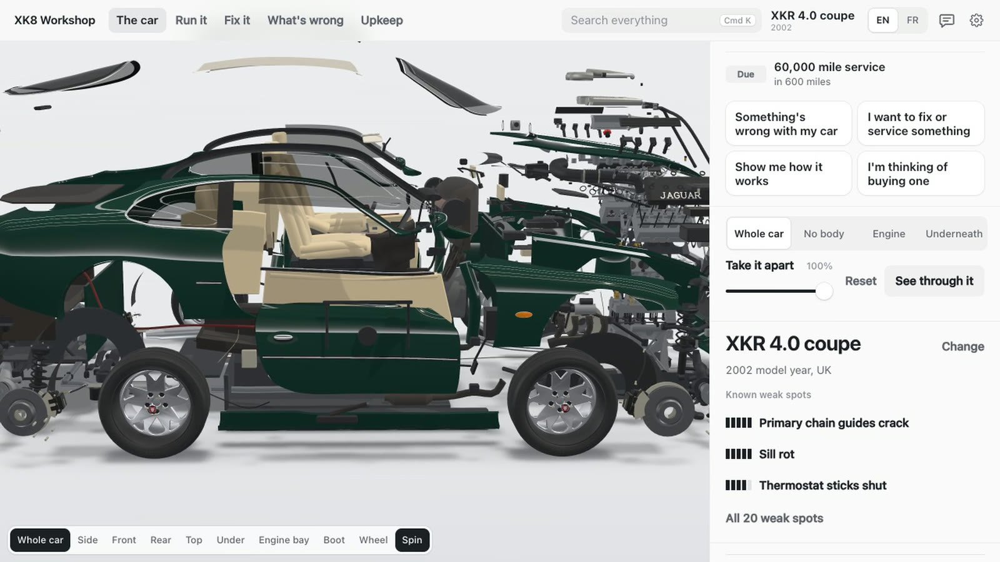
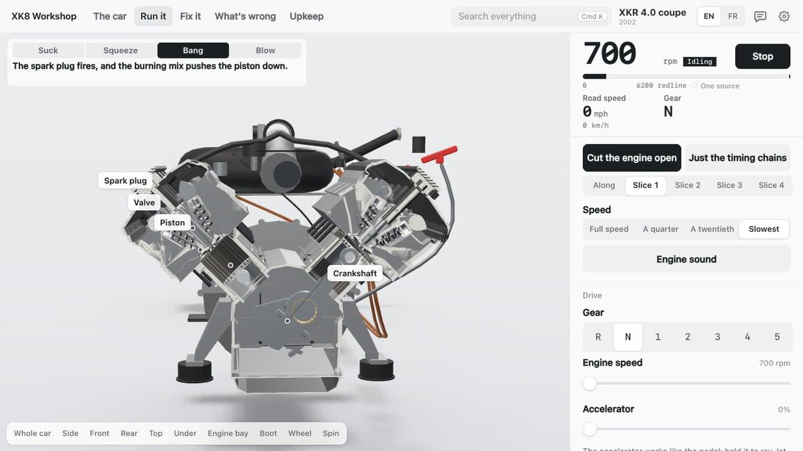
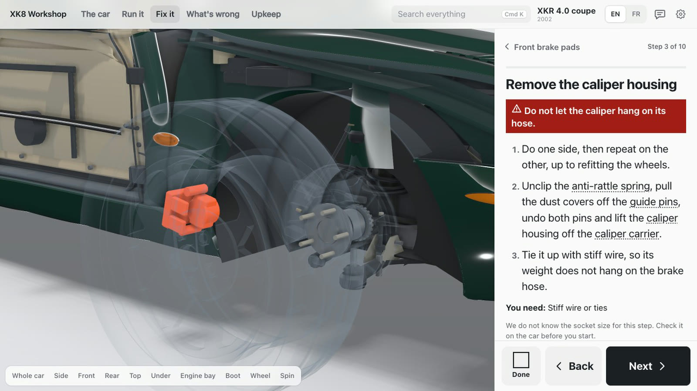
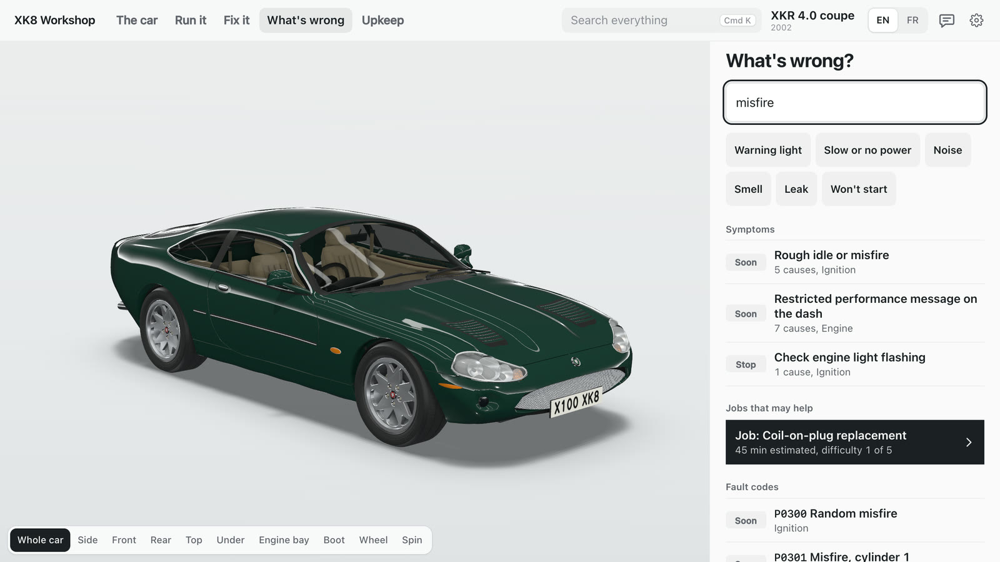
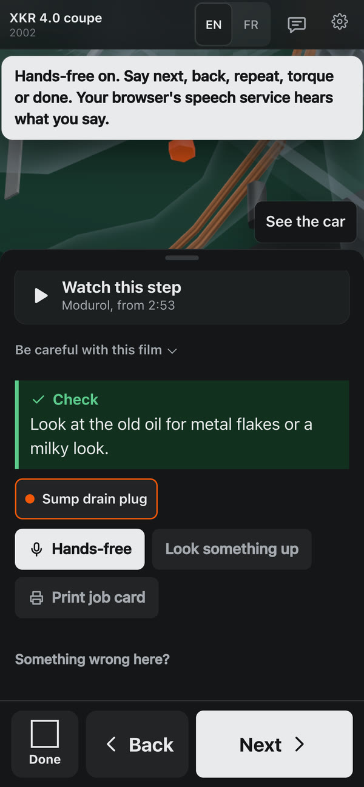

# XK8 Workshop

An interactive 3D workshop for the Jaguar XK8 and XKR (X100, 1996 to 2006), for owners working on the real car.

**https://xk8.paulcouach.com**

[](docs/media/tour.mp4)

*The full 26-second tour, with the engine cut open and a repair step: [docs/media/tour.mp4](docs/media/tour.mp4)*

Take the car apart in 3D, watch the engine run, and follow 43 repair jobs step by step with the torques, parts and tools for
your exact car. It also covers fault finding, servicing and buying checks. It is one page, made for a phone beside the car,
in English or French.

| | |
|---|---|
|  |  |
| **Take it apart.** Every part, with its numbers and torques for your car | **Run it.** The engine cut open and slowed down |
|  |  |
| **Fix it.** Step by step, with a film at the right moment | **What's wrong.** Plain words or a fault code |

<p align="center"><br><b>On a phone</b>, in dark mode, with hands-free reading each step out</p>

## How far to trust it

This is an unofficial owner resource, built by Claude, not connected with or endorsed by Jaguar. Check safety-critical values against a
factory source before relying on them. You work on your car at your own risk.

Every value shows its source and a confidence level. Nearly all torques come from Jaguar's own technical data. Part numbers
are weaker, and missing values stay blank rather than guessed. The gaps are in
[docs/research-summary.md](docs/research-summary.md). No mechanic has read the plain-language advice, no French reader has
read the French, and the linked films were chosen from their titles and captions, not watched. If you find a wrong value, please open an issue with your source.

## Run it locally

Needs Node 20 or later.

```
npm install
npm run build
```

Then open `dist/index.html`. It needs no server. `npm test` runs the fast checks. The rest of the commands are in
[AGENTS.md](AGENTS.md).

## Run it on a phone

The Android and iOS apps include the 3D car, workshop data, English and French. Videos, external guides and sending
feedback use the network. The installed app saves your car, service mileage and job progress on the device.

Use Node 22 or later for Capacitor. From the repository root, run this after checkout and after changes to the workshop.

```sh
npm ci
npm run mobile:sync
```

- **Android** — Open `android/` in Android Studio and run **app** on a device or emulator. With JDK 21 and the Android SDK
  configured, `cd android && ./gradlew assembleDebug` builds `app/build/outputs/apk/debug/app-debug.apk`.
- **iPhone** — On a Mac, open `ios/App/App.xcodeproj` in Xcode 26 or later. Choose the **App** scheme and an iPhone
  simulator. For a physical phone, select your development team in Signing & Capabilities, then select the phone and run.

For a garage trial, install the app and turn on airplane mode before opening it. Switch languages, turn the car with a
finger and open **Fix it → Engine oil and filter**. Start the job, mark the first step done and advance. Close the app
and reopen it. **Carry on** should open the same step with the first tick saved. **Share PDF** opens the phone’s share sheet with the job card attached.
Inspection reports and shopping lists use the same action.

The app assets build into `dist-mobile/`. The feedback API's allowed origins are in `worker/_worker.js`.
Mobile feedback delivery needs that version of the worker deployed to the existing Pages project.

### Check the apps

Both checks drive the installed app with real touches: touch target sizes, French, search, and turning and tapping the car.

- **Android** — With the debug app open on an emulator or a phone that `adb devices` lists, run
  `node tools/android-trial.mjs`.
- **iPhone** — On a Mac with [XcodeGen](https://github.com/yonaskolb/XcodeGen), install the app fresh on a booted
  simulator, then:

  ```sh
  cd tools/ios-trial && xcodegen generate
  xcodebuild test -project GarageTrial.xcodeproj -scheme GarageTrial -destination 'platform=iOS Simulator,name=<simulator>'
  ```

### Store builds

Neither app is in a store yet. Both projects are at version 0.1.0, build 1: raise `versionCode` and `versionName` in
`android/app/build.gradle`, and the version and build in Xcode, for each upload.

- **Google Play** — Make an upload key once and keep it, and its password, outside the repository:

  ```sh
  keytool -genkeypair -keystore ~/xk8-upload.jks -alias upload -keyalg RSA -keysize 2048 -validity 10000
  ```

  Then `cd android && XK8_UPLOAD_KEYSTORE=~/xk8-upload.jks XK8_UPLOAD_PASSWORD=<password> ./gradlew bundleRelease` writes
  the signed `app/build/outputs/bundle/release/app-release.aab`. Without the two variables the bundle is unsigned.
- **App Store** — The Xcode project names its development team. Sign in to that Apple account under Xcode > Settings >
  Accounts, then use Product > Archive and Distribute App. Use your own team for a fork.

## Docs

- [Architecture](docs/architecture.md) and [interfaces](docs/interfaces.md): how the code fits together
- [Data contract](docs/data-contract.md): the rules every fact follows
- [Research summary](docs/research-summary.md) and [data conflicts](docs/data-conflicts.md): sources, gaps and disagreements
- [French](docs/i18n.md): the translation contract
- [Status](docs/status.md): what is tested, known problems, publishing

## Credits and licence

The method follows [teardown](https://github.com/elvarofficial/teardown), and the shader warm-up comes from
[claude-motion](https://github.com/whaleyxbt/claude-motion). Built with [three.js](https://threejs.org). Their licences are
in [THIRD_PARTY_NOTICES.md](THIRD_PARTY_NOTICES.md).

Code and original text are under the MIT licence. Facts and specifications remain facts, and the sources cited in `data/`
keep their own rights. Jaguar, XK8, XKR and related names are trademarks of their owners and are used here only to identify
the car.
