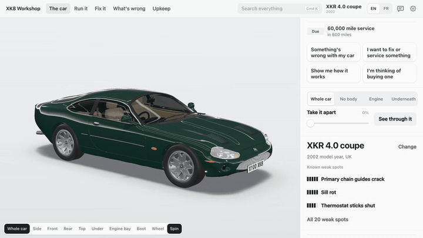
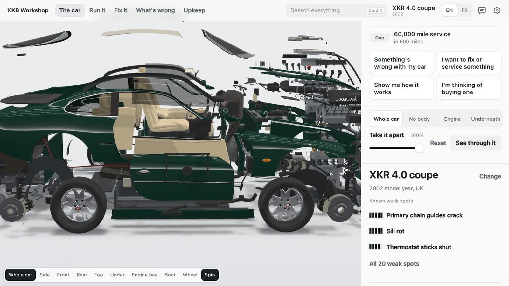
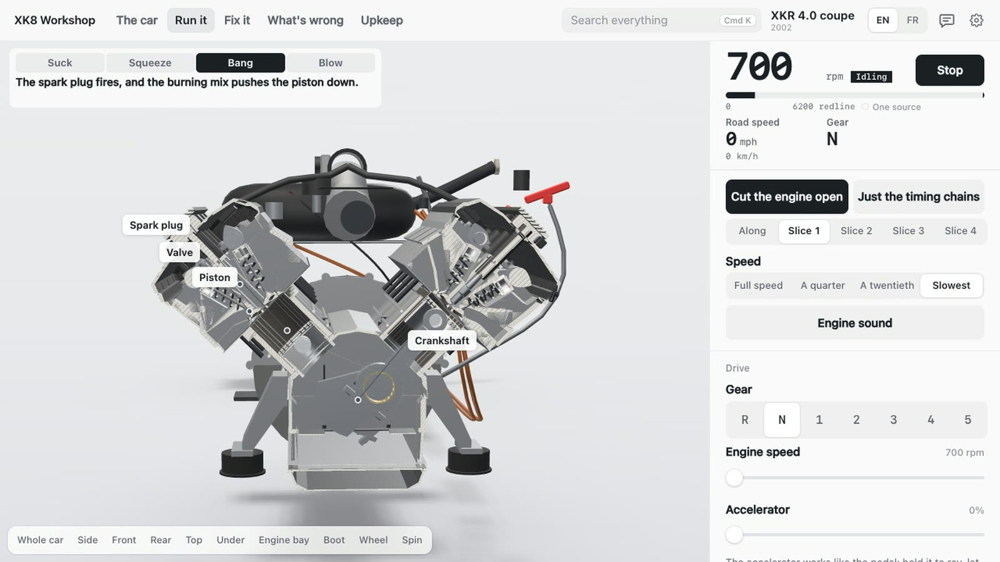
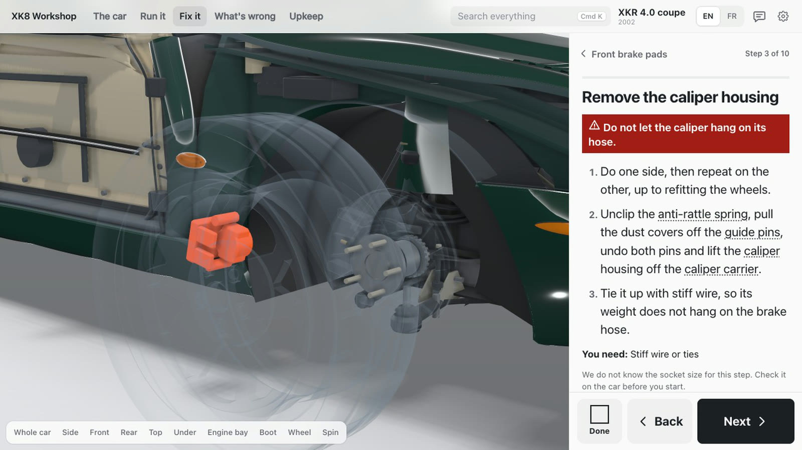
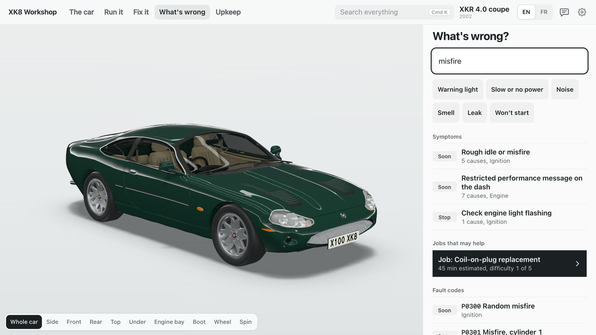
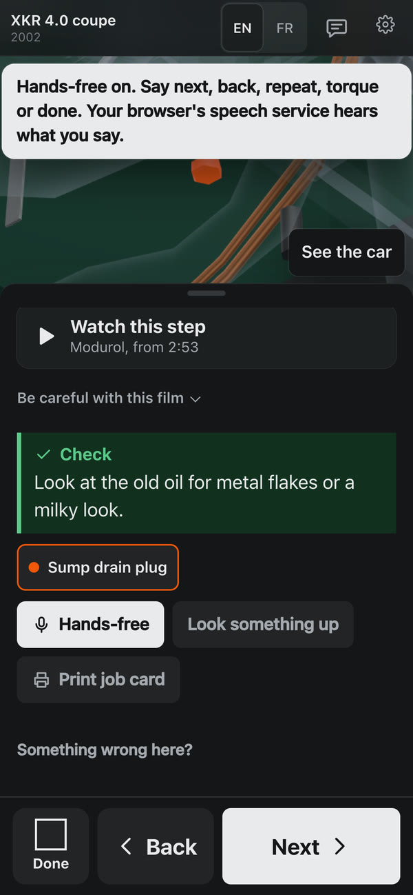

# XK8 Workshop

An interactive 3D workshop for the Jaguar XK8 and XKR (X100, 1996 to 2006), for owners working on the real car.

**https://xk8.paulcouach.com**

[](docs/media/tour.mp4)

*The full 26-second tour, with the engine cut open and a repair step: [docs/media/tour.mp4](docs/media/tour.mp4)*

Take the car apart in 3D, watch the engine run, and follow 43 repair jobs step by step with the torques, parts and tools for
your exact car. It also covers fault finding, servicing and buying checks. It is one page, made for a phone beside the car,
in English or French.

| | |
|---|---|
|  |  |
| **Take it apart.** Every part, with its numbers and torques for your car | **Run it.** The engine cut open and slowed down |
|  |  |
| **Fix it.** Step by step, with a film at the right moment | **What's wrong.** Plain words or a fault code |

<p align="center"><br><b>On a phone</b>, in dark mode, with hands-free reading each step out</p>

## How far to trust it

This is an unofficial owner resource, built by Claude, not connected with or endorsed by Jaguar. Check safety-critical values against a
factory source before relying on them. You work on your car at your own risk.

Every value shows its source and a confidence level. Nearly all torques come from Jaguar's own technical data. Part numbers
are weaker, and missing values stay blank rather than guessed. The gaps are in
[docs/research-summary.md](docs/research-summary.md). No mechanic has read the plain-language advice, no French reader has
read the French, and the linked films were chosen from their titles and captions, not watched. If you find a wrong value, please open an issue with your source.

## Run it locally

Needs Node 20 or later.

```
npm install
npm run build
```

Then open `dist/index.html`. It needs no server. `npm test` runs the fast checks. The rest of the commands are in
[AGENTS.md](AGENTS.md).

## Docs

- [Architecture](docs/architecture.md) and [interfaces](docs/interfaces.md): how the code fits together
- [Data contract](docs/data-contract.md): the rules every fact follows
- [Research summary](docs/research-summary.md) and [data conflicts](docs/data-conflicts.md): sources, gaps and disagreements
- [French](docs/i18n.md): the translation contract
- [Status](docs/status.md): what is tested, known problems, publishing

## Credits and licence

The method follows [teardown](https://github.com/elvarofficial/teardown), and the shader warm-up comes from
[claude-motion](https://github.com/whaleyxbt/claude-motion). Built with [three.js](https://threejs.org). Their licences are
in [THIRD_PARTY_NOTICES.md](THIRD_PARTY_NOTICES.md).

Code and original text are under the MIT licence. Facts and specifications remain facts, and the sources cited in `data/`
keep their own rights. Jaguar, XK8, XKR and related names are trademarks of their owners and are used here only to identify
the car.
